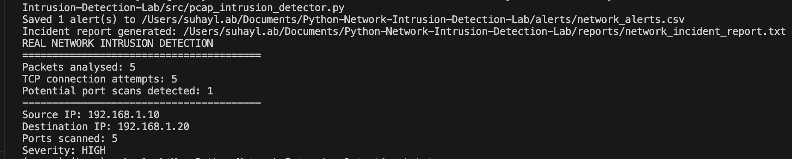
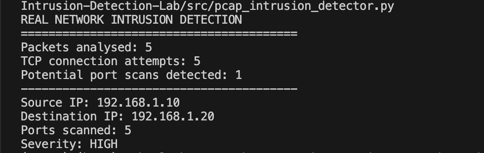
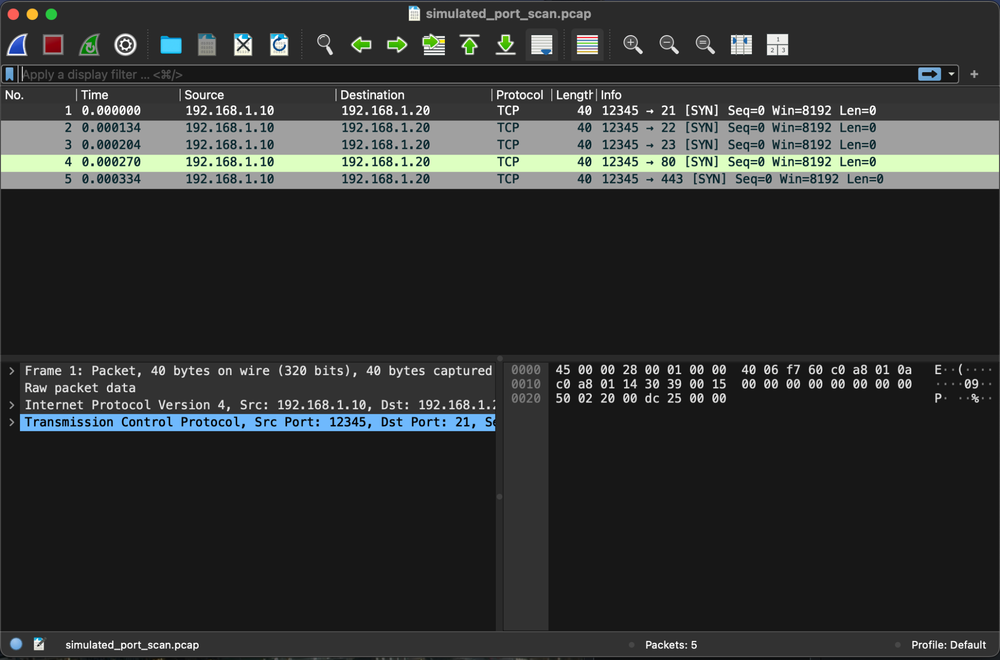
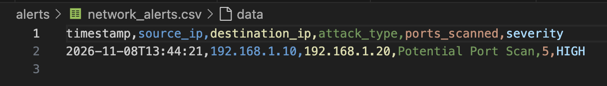
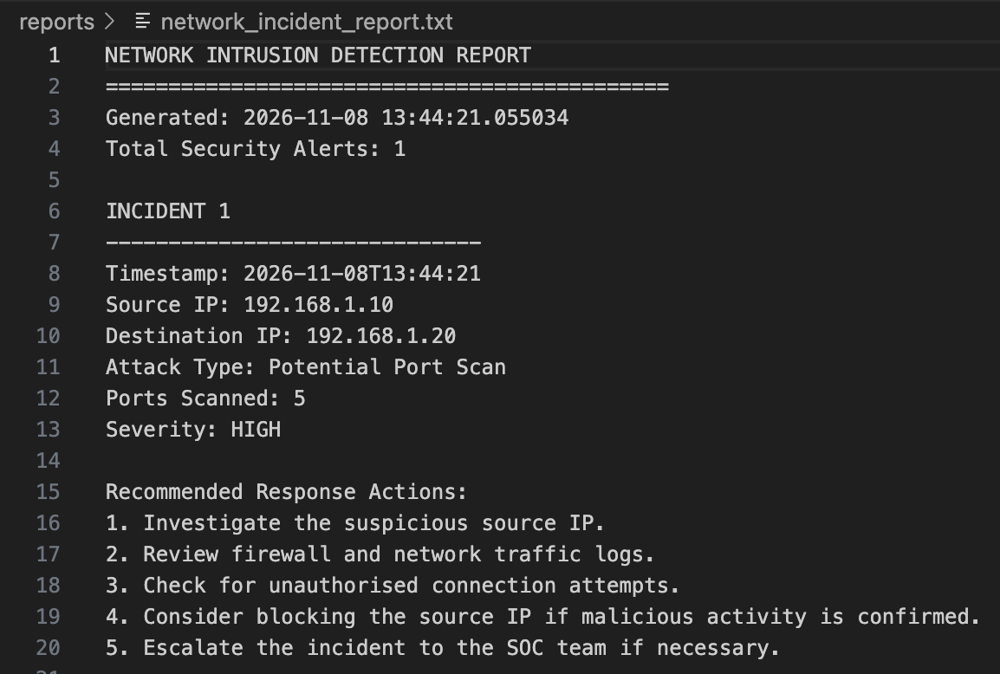

# Python Network Intrusion Detection Lab

A Python-based cybersecurity project that analyses network packet captures, identifies potential TCP port scanning activity, generates security alerts, and produces incident response reports.

This project demonstrates practical network traffic analysis, intrusion detection, security monitoring, and incident reporting using Python, Scapy, and Wireshark.

## Project Overview

The lab simulates a basic Network Intrusion Detection System (NIDS).

It supports:
- Analysing network traffic captured using Wireshark
- Reading PCAP and PCAPNG files using Scapy
- Identifying TCP connection attempts
- Detecting potential port scanning activity
- Generating CSV security alerts
- Producing incident response reports
- Testing detection logic using simulated traffic

## Technologies Used

- Python 3
- Scapy
- Wireshark
- TCP/IP networking
- CSV
- Python unittest
- Visual Studio Code
- Git and GitHub

## How It Works

1. Network traffic is captured using Wireshark or generated using Scapy.
2. Python reads the packet capture.
3. TCP SYN packets are extracted as connection attempts.
4. The detection engine groups connection attempts by source and destination.
5. Multiple distinct destination ports within a time window trigger a potential port scan alert.
6. Alerts are saved to a CSV file.
7. An incident report is generated with recommended response actions.

## Project Structure

```text
Python-Network-Intrusion-Detection-Lab/
├── src/
│   ├── alert_generator.py
│   ├── generate_test_pcap.py
│   ├── incident_report.py
│   ├── network_ids.py
│   ├── packet_analyzer.py
│   ├── pcap_analyzer.py
│   ├── pcap_intrusion_detector.py
│   └── port_scan_detector.py
├── tests/
│   ├── test_alert_generator.py
│   └── test_port_scan_detector.py
├── data/
│   ├── network_capture.pcapng
│   └── simulated_port_scan.pcap
├── alerts/
│   └── network_alerts.csv
├── reports/
│   └── network_incident_report.txt
├── screenshots/
├── README.md
└── .gitignore
```

## Installation

Clone the repository and enter the project directory.

Create and activate a Python virtual environment:

```bash
python3 -m venv .venv
source .venv/bin/activate
```

Install Scapy:

```bash
python3 -m pip install scapy
```

Wireshark can be installed separately to inspect network traffic.

## Running the Lab

### 1. Generate simulated port scan traffic

```bash
python3 src/generate_test_pcap.py
```

Creates `data/simulated_port_scan.pcap` containing five simulated TCP SYN packets targeting different ports.

### 2. Analyse the simulated packet capture

```bash
python3 src/pcap_intrusion_detector.py
```

Expected detection results:

```text
REAL NETWORK INTRUSION DETECTION
========================================
Packets analysed: 5
TCP connection attempts: 5
Potential port scans detected: 1
----------------------------------------
Source IP: 192.168.1.10
Destination IP: 192.168.1.20
Ports scanned: 5
Severity: HIGH
```

### 3. Analyse a Wireshark capture

```bash
python3 src/pcap_analyzer.py
```

Reads `data/network_capture.pcapng` and displays packet information, including source addresses, destination addresses, and protocols.

### 4. Run the simulated detection pipeline

```bash
python3 src/network_ids.py
```

Runs the simulated connection-event detector, saves security alerts, and generates an incident report.

### 5. Run automated tests

```bash
python3 -m unittest discover -s tests -v
```

The tests cover normal traffic, potential port scan detection, and CSV alert generation.

## Security Alert Generation

Detected activity is written to:

`alerts/network_alerts.csv`

Recorded fields include:

- Timestamp
- Source IP address
- Destination IP address
- Attack type
- Number of ports scanned
- Severity

## Incident Response Reporting

The system generates:

`reports/network_incident_report.txt`

The report includes detected activity, affected IP addresses, severity, and recommended response actions.

Example recommendations include reviewing firewall logs, investigating suspicious sources, checking for unauthorised connections, and escalating confirmed incidents.

## Testing and Validation

The project was tested using simulated TCP SYN traffic.

Observed results:

| Test | Result |
|---|---|
| Normal traffic detection | Passed |
| Simulated port scan detection | Passed |
| CSV security alert generation | Passed |
| Simulated PCAP detection | Passed |
| Wireshark PCAPNG analysis | Passed |
| Incident report generation | Passed |

## Limitations

- This is an educational intrusion detection prototype, not a production-ready IDS.
- Port scan detection uses a configurable threshold and time window.
- A port scan alert indicates suspicious activity, not proof of malicious intent.
- Captured packets are analysed offline rather than through continuous live monitoring.
- Simulated traffic is used to validate the detection logic.
- Encrypted application traffic is not decrypted or inspected.

## Cybersecurity Skills Demonstrated

- Network traffic analysis
- TCP/IP and packet inspection
- PCAP and PCAPNG processing
- Intrusion detection logic
- Python security automation
- Security alert generation
- Incident response documentation
- Unit testing
- Wireshark and Scapy

## Project Screenshots

### 1. Complete Intrusion Detection Pipeline


### 2. PCAP Port Scan Detection


### 3. Wireshark Port Scan Capture


### 4. Generated Security Alerts


### 5. Network Incident Report


## Disclaimer

This project is intended for cybersecurity education, defensive security research, and authorised testing only. Packet captures should be collected only from networks where monitoring is permitted.
